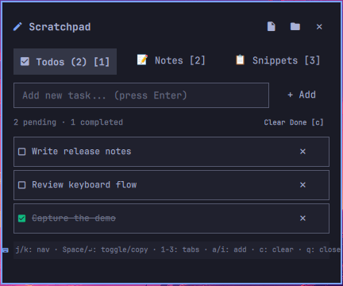
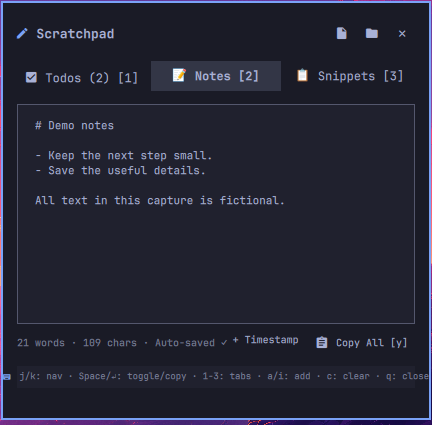
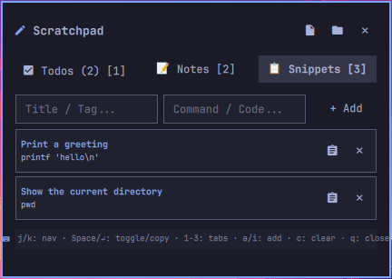

<div align="center">

# 󰏫 scratchpad

### Instant bar notes, scratchpad & daily todo list for Omarchy

[](https://omarchy.org/)
[](https://hyprland.org/)
[](LICENSE)

*A lightweight, keyboard-driven scratchpad, daily checklist, and snippet bank directly in your status bar.*

</div>

---

## Overview

**Scratchpad** is a productivity widget for [Omarchy Linux](https://omarchy.org/). It gives you an instant place to capture fleeting thoughts, track daily tasks, and store frequently used code snippets. All data is saved as plain text and standard JSON in `~/.local/share/omarchy/scratchpad/`, making it easy to sync via Git, Syncthing, or edit in Neovim.

### Highlights

- **󰄲 Daily Todo Checklist:** Fast inline task entry (<kbd>Enter</kbd>), keyboard-driven checkbox toggling, and task clearing.
- **📝 Instant Scratchpad:** Auto-saving multi-line markdown notes with word/character counts and quick timestamp insertion.
- **📋 Code Snippets Bank:** Save terminal commands, regex patterns, and hex codes with 1-click / 1-key copying (`wl-copy`).
- **⌨️ Keyboard-First:** Vim keys (`j`/`k`, `1-3`, `h`/`l`, `Space`, `x`, `d`, `y`, `q`) with active cursor tracking.
- **🎨 Native Theme Integration:** Inherits your active Omarchy theme colors, typography, borders, and animations automatically.

---

## Screenshots

Captured on Omarchy 4.0.4-1 / Hyprland 0.56.2, using the active desktop theme
and [fictional demo data](docs/demo-fixture.json).

| Default bar | Compact bar |
| :---: | :---: |
|  |  |

| Todos | Notes | Snippets |
| :---: | :---: | :---: |
|  |  |  |

[Capture details and limitations](docs/native-demo.md). These images show the
rendered views; they do not verify the keyboard flow.

---

## Keyboard Navigation

When the popup is open, you can navigate and edit with the keyboard:

| Key | Action |
| :--- | :--- |
| `j` / `↓` | Move cursor down |
| `k` / `↑` | Move cursor up |
| `1` | Switch to **Todos** tab |
| `2` | Switch to **Notes** tab |
| `3` | Switch to **Snippets** tab |
| `h` / `l` (or `Tab` / `Shift+Tab`) | Cycle through tabs |
| `Space` / `Enter` | Toggle todo checkbox / Copy snippet |
| `a` / `i` | Focus new item input field |
| `x` / `d` | Delete focused item |
| `c` | Clear completed tasks |
| `y` | Copy active note / snippet to clipboard (`wl-copy`) |
| `e` | Open `notes.md` in your terminal `$EDITOR` |
| `q` / `Esc` | Close popup |

---

## Installation

Install via the Omarchy plugin manager:

```bash
omarchy plugin add https://github.com/AzambekDev/omarchy-scratchpad.git --enable --yes
```

### Manual Install

```bash
git clone https://github.com/AzambekDev/omarchy-scratchpad.git ~/.config/omarchy/plugins/azambekdev.scratchpad
omarchy-shell shell rescanPlugins
omarchy plugin enable azambekdev.scratchpad right
```

---

## Global Keybinding

To toggle Scratchpad with a global shortcut in Hyprland, add this to `~/.config/hypr/bindings.lua`:

```lua
-- Scratchpad toggle with Super+Ctrl+M
o.bind("SUPER + CTRL + M", "Scratchpad", "omarchy-shell shell toggle azambekdev.scratchpad '{}'")
```

---

## Storage & Sync

All notes and tasks are persisted locally in plain text:

```
~/.local/share/omarchy/scratchpad/
├── notes.md       # Markdown scratchpad memo
├── todos.json     # Active & completed tasks
└── snippets.json  # Saved code & command snippets
```

---

## Configuration

Customize behavior in `~/.config/omarchy/shell.json` under `bar.layout`:

```jsonc
{
  "id": "azambekdev.scratchpad",
  "defaultTab": "todos",      // Default tab on open ("todos", "notes", "snippets")
  "showTaskCount": true,      // Show pending tasks badge in bar
  "compactView": false        // Compact icon-only bar mode
}
```

---

## IPC Interface

Control Scratchpad from scripts or keybindings:

```bash
omarchy-shell call azambekdev.scratchpad open       # open popup
omarchy-shell call azambekdev.scratchpad close      # close popup
omarchy-shell call azambekdev.scratchpad toggle     # toggle popup
omarchy-shell call azambekdev.scratchpad clearDone  # clear completed todos
omarchy-shell call azambekdev.scratchpad copyNotes  # copy notes to clipboard
```

---

## License

[MIT](LICENSE) © [Azambek Sattarov](https://github.com/AzambekDev)
